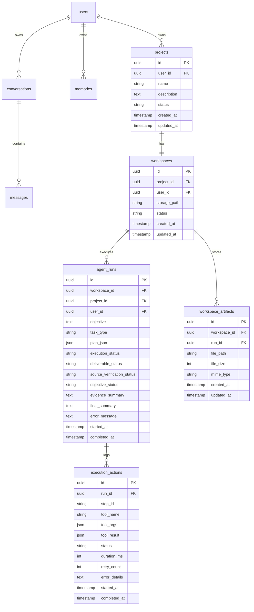

# Rorak AI — Agent Workspace Integration Architecture & Audit Report
**Track 01 — Artificial Intelligence & Machine Learning (AI-01: The AI That Can Act)**
**Document Version:** 1.0.0  
**Date:** 2026-10-23  

---

## 1. Executive Summary & Problem Statement Alignment

The goal of this integration is to transform **Rorak AI** (https://www.rorak.tech) from a conversational, document-grounded chatbot into a **competition-ready, autonomous task-execution platform** that fulfills the Hackathon AI-01 requirement:
> *"Build an intelligent AI agent capable of understanding a user's objective, breaking it into smaller tasks, selecting appropriate tools or resources, executing the workflow, and presenting the result with a clear record of the actions it performed."*

### Key Tenets
1. **Rorak AI Remains the Primary Product:** All existing authentication, PostgreSQL database models, Alembic migrations, chat conversations, multi-turn memory, RAG pipeline, and branding are preserved.
2. **Agent Co Supplies the Autonomous Execution Engine:** The stateful LangGraph orchestration, dynamic tool registry, deterministic factual verification engine, sandboxed workspace filesystem, real-time SSE streaming, and ZIP archive generation from Agent Co are integrated directly into Rorak AI.
3. **Antigravity-Inspired Cloud Development Workspace:** The frontend is extended with a professional 3-pane IDE layout:
   - **Left Sidebar:** Rorak AI branding, Chat, Memory, Agent Workspace navigation, and Projects list.
   - **Center Main Workspace:** Project toolbar, Objective composer, File explorer tree, syntax-highlighted code editor with multi-tab support, artifact previews, and one-click ZIP export.
   - **Right Sidebar (Agent Control Panel):** Live Workflow Graph & Stream Logs, Inspectable Action Audit Trail (with tool arguments, outputs, execution duration, and source citations), and Prompts inspector.
4. **Cloud-First Persistence:** Workspace projects, files, and agent runs persist in PostgreSQL and server storage, surviving page reloads and server restarts.

---

## 2. Audit of Existing Codebases

### Project A — Rorak AI (`E:\Coding\Hackathons\JU-Techfest 26`)
- **Type:** Full-stack production application deployed to `https://www.rorak.tech` (frontend on Firebase Hosting / Nginx, backend on FastAPI / PostgreSQL).
- **Backend Architecture:**
  - `backend/main.py`: FastAPI app with CORS (`rorak.tech`, `web.app`, `localhost:3000`, `localhost:5173`, `localhost:8000`), rate limiting, request logging, and health routes.
  - `backend/core/`: Configuration (`config.py` loading `GROQ_API_KEY`, `JWT_SECRET_KEY`, `EMBEDDING_MODEL`), database session (`database.py` with SQLAlchemy 2.0 DeclarativeBase and connection pooling), JWT auth (`auth.py` with `get_current_user` dependency).
  - `backend/models/db/`: Clean PostgreSQL models with UUID primary keys: `User`, `Conversation`, `Message`, `Memory`, `Document`, `DocumentChunk`, `IngestionJob`.
  - `backend/repositories/`: Repository pattern isolating database queries.
  - `backend/parsers/`: Document parser adapters for CSV, DOCX, Markdown, PDF, TXT.
  - `backend/rag/`: Vector store, embeddings (`all-MiniLM-L6-v2`), cross-encoder reranker, and context-stuffed generation.
- **Frontend Architecture:**
  - Vanilla JS SPA (`frontend/index.html`, `script.js`, `style.css`), highly optimized for fast loading and mobile responsiveness.
  - Stores JWT token in `localStorage.getItem("rorak_access_token")`.
  - Views: `chat`, `docs`, `memory`.

### Project B — Agent Co (`E:\Coding\Hackathons\JU-TF-26`)
- **Type:** LangGraph-based agentic task planning and execution engine.
- **Core Components:**
  - `agent/graph.py`: Multi-phase LangGraph workflow (`planner` $\rightarrow$ `architect` $\rightarrow$ `coder`), structured `GoalPlan` decomposition, evidence compilation, and deliverable report synthesis.
  - `agent/tools_registry.py`: Extensible tool registry with strict schema validation. Registered tools include `web_search`, `fetch_url_content`, `get_github_repo_metadata`, `write_file`, `read_file`, `list_files`, and `delete_file`.
  - `agent/verification_engine.py`: Deterministic verification engine (`FactualVerifier`) checking deliverable existence, length, unresolved template placeholders (`{{...}}`, `【...†source】`), official metric grounding, and source citation traceability.
  - `agent/workspace.py`: Isolated filesystem workspace operations, directory tree listing, and ZIP archive packaging.
  - `agent/state.py`: TypedDict state and Pydantic schemas (`GoalPlan`, `ActionStep`, `ActionExecutionRecord`, `VerificationResult`).
  - `frontend/`: React + Vite + Tailwind + Zustand studio interface with live graph visualization, audit cards, and Monaco editor.

---

## 3. Integration Plan & Component Mapping

| Component | Rorak AI (Current) | Agent Co (Current) | Target Unified Architecture |
|---|---|---|---|
| **Primary Backend** | FastAPI (`backend/`) | FastAPI (`agent/api.py`) | Single unified FastAPI server in `backend/` |
| **Database** | PostgreSQL / SQLAlchemy 2.0 | Ephemeral SQLite / in-memory | PostgreSQL via SQLAlchemy models + Alembic migrations |
| **Authentication** | JWT Bearer (`User` table) | Optional header / open | JWT Bearer authentication protecting all workspace & run endpoints |
| **Agent Engine** | Conversational LLM + RAG | LangGraph state graph | Integrated LangGraph agent pipeline under `backend/agent/` |
| **Tool Registry** | Document retrieval RAG | General Tool Registry | `backend/agent/tools_registry.py` with multi-domain tools |
| **Verification** | None | `FactualVerifier` | Deterministic verification in `backend/agent/verification_engine.py` |
| **Workspace Storage** | Document uploads in `documents/` | Ephemeral `tempfile` | Persistent workspaces in `workspaces/{workspace_id}/` |
| **Frontend** | Vanilla JS Chat & Memory UI | React Studio | Extended Rorak UI with embedded Antigravity Workspace IDE |

---

## 4. Database Schema Extensions

To support project management and agent run persistence, the existing schema is extended with 5 backward-compatible tables:

---

## 5. Tool Registry & Multi-Domain Capabilities

To address the competition requirements, the tool registry provides capabilities across three distinct domains:

1. **Research Automation:**
   - `web_search`: Live search via Tavily API / DuckDuckGo.
   - `fetch_url_content`: In-depth webpage fetching and content extraction.
   - `get_github_repo_metadata`: Verified star counts, licenses, and release versions.
2. **Deterministic Data Analysis:**
   - `data_analysis_calc`: Statistical analysis (mean, median, standard deviation, min/max, missing value detection) on structured CSV datasets.
3. **Software Generation & Workspace Operations:**
   - `write_file`: Create and update workspace files with path sandboxing.
   - `read_file`: Read back generated files for verification.
   - `list_files`: Traverse directory structures.
   - `delete_file`: Remove temporary files.

---

## 6. Frontend UI Architecture (Antigravity-Inspired)

The unified interface provides seamless transitions between conversational assistance and full development tasks:
- **Left Sidebar:** Rorak AI branding, Chat (`#`), Memory (`#`), and new **Agent Workspace** tab (`#navAgentBtn`). Includes a **Projects** list with `+ New Project`.
- **Center Working Area:**
  - **Toolbar:** Project title, Active run badge, Run Objective button, Reset Workspace, Download ZIP button.
  - **Objective Bar:** Clear multi-line prompt input to submit user tasks.
  - **File Explorer & Code Editor:** File tree on the left, tabbed code editor with syntax highlighting, line numbers, unsaved indicators, and real-time artifact previews.
- **Right Sidebar (Agent Control Panel):**
  - **Graph & Logs Tab:** Real-time workflow nodes (`planner`, `architect`, `coder`), active state indicator, and streaming execution logs.
  - **Audit Trail Tab:** Structured cards for every tool execution showing tool name, step ID, duration, status, inputs, and results.
  - **Prompts Tab:** Editable and inspectable prompt templates for each node.

---

## 7. Cloud Persistence & ZIP Export

- **Storage Location:** Persistent directory structure `workspaces/{workspace_id}/` backed by local filesystem or mounted persistent volume.
- **ZIP Export Endpoint:** `GET /api/agent/workspaces/{workspace_id}/download` builds an in-memory ZIP archive of the active workspace, securely excluding `.env`, secrets, and server runtime files.
- **User Isolation:** All workspace, project, and run endpoints enforce `user_id == current_user.id` or require authorized access.
